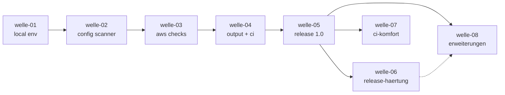

# Roadmap

**Status:** Aktiv. **Letzte Änderung:** 2026-11-11.

**Format-Regel:** Die Roadmap ist eine Reihenfolge von **Wellen**, keine
Reihenfolge von Terminen. Die Wellen bilden die Versions-Stufen
`LH-RM-*` des Lastenhefts ab.

---

## Aktuelle Welle

Keine Welle aktiv; Wartung ohne Welle: [`slice-035`](slice-035-reviewer-skill.md) (Reviewer-Skill) liegt in `in-progress/`. Zuletzt abgeschlossen: Wartung ohne Welle, [`slice-034`](../done/slice-034-devcontainer-cli-aktualisieren.md) (devcontainer-CLI 0.90.0).

welle-01 bis welle-07 sind abgeschlossen. Release 1.0.0 ist am 2026-11-11 veröffentlicht
(Tag `v1.0.0` auf Commit `5f1b35cca776`, GitHub-Release, Images auf `ghcr.io`, Devcontainer-Feature),
danach Werkzeug 1.1.0 (Tag `v1.1.0`, GitHub-Release, Images `1.1.0-slim` und `1.1.0-full`) und Feature 1.0.1
(Tag `feature-v1.0.1`), beide auf Commit `5274f3dce55f`,
siehe [`../done/welle-01-results.md`](../done/welle-01-results.md),
[`../done/welle-02-results.md`](../done/welle-02-results.md),
[`../done/welle-03-results.md`](../done/welle-03-results.md),
[`../done/welle-04-results.md`](../done/welle-04-results.md) und
[`../done/welle-05-results.md`](../done/welle-05-results.md),
[`../done/welle-06-results.md`](../done/welle-06-results.md) und [`../done/welle-07-results.md`](../done/welle-07-results.md). Die Pläne liegen unter
[`../done/`](../done/), zuletzt [`../done/welle-07-ci-komfort.md`](../done/welle-07-ci-komfort.md).

Als Nächstes steht nur welle-08 an; sie startet erst nach einer Entscheidung der Auftraggeber. Sobald kein Slice mehr in `in-progress/` liegt, trägt dieser Block wieder den Ruhe-Marker für den Ruhezustand.

## Nächste Wellen

Versionsnummern nach 1.0 sind projektintern (das Lastenheft kennt `LH-RM-*` nur bis Version 1.0); jede Veröffentlichung
braucht das Ja beider Nutzer.

| Welle | Ziel | Trigger | Wichtigste Slices | Aufwand |
|---|---|---|---|---|
| welle-08-erweiterungen | Erweiterungen und Härtung (nach Entscheidung) | je Slice: Entscheidung der Auftraggeber bzw. ADR | 030 `iam-policy.json`, 031 `coverage-gate`, 032 Sigstore/SBOM, 033 macOS/Windows | M bis L |

Pläne: [`../done/welle-06-release-haertung.md`](../done/welle-06-release-haertung.md), [`../done/welle-07-ci-komfort.md`](../done/welle-07-ci-komfort.md), [`../welle-08-erweiterungen.md`](../welle-08-erweiterungen.md).

## Meilensteine

| Meilenstein | Welle(n) | Trigger | Status |
|---|---|---|---|
| M0 — Harness bereit | — | Greenfield-Bootstrap abgeschlossen | erreicht (2026-06-24) |
| M1 — erstes lauffähiges Tool | welle-01 | `bedrock-eu-check local` liefert PASS/WARN/FAIL + Exit-Codes | erreicht (2026-11-10) |
| M2 — vollständiger statischer Scan | welle-02 | Config/Container/Terraform abgedeckt | erreicht (2026-11-10) |
| M3 — AWS-Live-Checks | welle-03 | STS/Bedrock/IAM read-only | erreicht (2026-11-10) |
| M4 — CI-fähig | welle-04 | SARIF + `--ci` + Exit-Code 1 bei FAIL | erreicht (2026-11-10) |
| M5 — Release 1.0 | welle-05 | Docker-Image + Doku + Tests grün | erreicht (2026-11-11, veröffentlicht) |
| M6 — Release-Prozess erprobt | welle-06 | `release-artifacts` und Feature erprobt, `release-create` vorhanden | erreicht (2026-11-11; Feature 1.0.1 veröffentlicht) |
| M7 — CI-Komfort (1.1.0) | welle-07 | `--fail-on warn`, `--output FILE`, Zusatzregionen, Gate-Bewertung | erreicht (2026-11-11; 1.1.0 veröffentlicht) |
| M8 — Erweiterungen | welle-08 | je Slice: Entscheidung der Auftraggeber bzw. ADR | offen (nicht freigegeben) |

## Abhängigkeitsgraph

## Abgeschlossene Wellen

- welle-01-lokaler-env-check, abgeschlossen 2026-11-10, siehe [`done/welle-01-results.md`](../done/welle-01-results.md).
- welle-02-config-scanner, abgeschlossen 2026-11-10, siehe [`done/welle-02-results.md`](../done/welle-02-results.md).
- welle-03-aws-checks, abgeschlossen 2026-11-10, siehe [`done/welle-03-results.md`](../done/welle-03-results.md).
- welle-04-output-ci, abgeschlossen 2026-11-10, siehe [`done/welle-04-results.md`](../done/welle-04-results.md).
- welle-05-release, abgeschlossen 2026-11-11 (Release 1.0.0 veröffentlicht), siehe [`done/welle-05-results.md`](../done/welle-05-results.md).

## Historische Trigger-Verschiebungen

- **Slice-Lifecycle nicht eingehalten (festgestellt am 2026-11-11):** Die Slices 001 bis 029 gingen von `open/` direkt nach
  `done/`; `next/` und `in-progress/` blieben ungenutzt, obwohl [`../README.md`](../README.md) und `AGENTS.md` §3.3 den Weg
  `open → next → in-progress → done` verlangen. Das war ein Versehen beider Agenten, kein bewusster Entscheid. Die Moves werden
  **nicht rückwirkend** nachgebildet. **Ab slice-024 gilt der Lifecycle:** Start = reiner `git mv` nach `next/` (Verantwortlicher im
  Plan benannt), PR/Branch = `in-progress/`, Abschluss = `done/`. Das `d-check`-Modul `planning` soll danach als Gate aufgenommen
  werden (Folgeslice).
